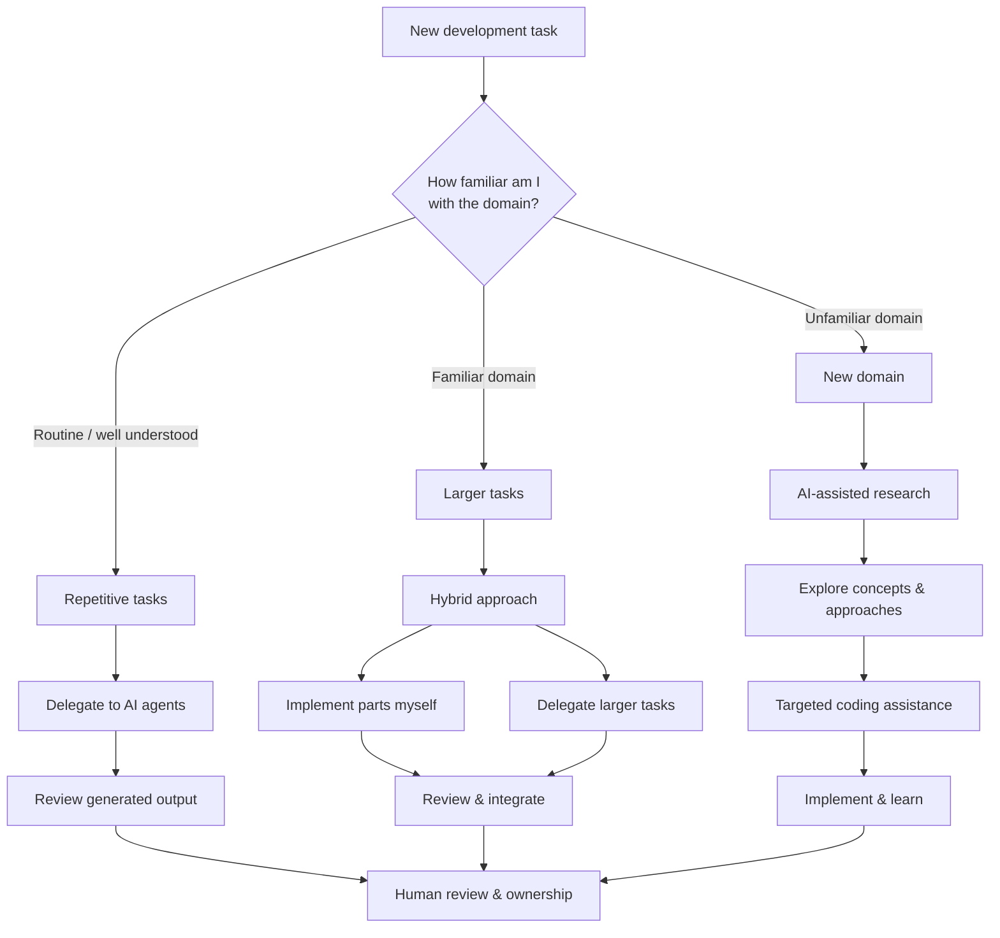

In my [Hello World post](001-hello-world) I wrote that I want to keep doing my own thinking. This post is about how hard that is in practice, with deadlines coming up, being forced to build fast and hence use AI.

Fair warning: this is my experience, not a study. Where research exists, I link it and say how far it carries.

## What it feels like

Working with AI all day feels a bit like scrolling Social Media to me. Lots of contexts, constant switching, a stream of output to check, and never one problem for long enough to sink into it.

I noticed this particularly while working on my thesis project. I had been working on the same topic for almost six months. Progress was gradual, but tangible. Every day I understood a little more, improved something, or solved another small problem. It was not always exciting, but there was a sense of ownership over what I was building.
By that point, I was already getting tired of the repetitive workflow. Then AI became a much bigger part of it.
Instead of making the work more enjoyable, it sometimes took away the part I actually liked: thinking through problems, exploring solutions, and figuring things out myself. I increasingly found myself prompting, looking at the generated output, prompting again, and repeating the cycle. Sometimes I would eventually realize that I had no idea what I was actually doing anymore. At that point, the only reasonable option was to step back and start over.

At the same time, AI made it incredibly easy to work on multiple things in parallel. I could quickly explore an interesting idea, start a side project, or experiment with a new technology without investing much time upfront. Naturally, I started doing more of that. Whenever my thesis became tedious, there was always something else more exciting to work on. But this came at a cost. I kept switching between my thesis, side projects, and different AI conversations. Each context required me to pick up where I had left off, understand new output, and make decisions. And even when I switched to something I genuinely enjoyed, I often ended up spending more time reviewing AI-generated code than actually building something myself. It became a bit of a vicious cycle: my thesis felt increasingly tedious, so I looked for distractions. AI made those distractions easier to pursue, but the constant context switching left me even more mentally exhausted. Eventually, even the things I actually wanted to work on started feeling like work.

The strange part is that I was technically getting more done, or at least producing more output. Yet the actual experience of developing software became less enjoyable. I was spending more time supervising work than doing the work myself.

There is a name for this now. Researchers from BCG and UC Riverside surveyed 1,488 full-time US workers and called it "AI brain fry": mental fatigue from using or overseeing AI tools beyond your cognitive capacity. About 14% of the AI users in the sample said they had experienced it.[^bcg-news] The most draining work was oversight, meaning reading and checking what the AI produced. Workers doing a lot of it reported 12% more mental fatigue and 19% more information overload.[^bcg-fortune] Productivity also started to drop once people used more than three AI tools at the same time.[^bcg-euronews]

Two things I find worth keeping in mind. First, this was a survey based on self-reports, so it shows an association, not a cause. Second, the same study found that AI replacing routine tasks went along with less burnout.[^bcg-ebsco] So the problem looks like babysitting the machine, not using it at all.

The older research on task switching points the same way. Leroy showed in experiments that people struggle to pull their attention away from an unfinished task, and their performance on the next one suffers.[^leroy] Many parallel chats and agents are basically unfinished tasks stacked on top of each other.

## Am I getting dumber?

I try not to outsource everything. Still, I catch myself asking questions I never used to ask: Can I still program properly? Can I explain what I built?

The second one hurts most. When someone asks a follow-up question about code I "wrote" with AI, I sometimes stumble, because I simply know that code less than code I typed myself. Which is expected, but it is still a bit of a shock. I can read and understand it, but I don't have the same mental model of it as code I wrote myself. But still people expect me to know it, because I am the one who prompted it. It is a strange feeling.

There is some research here, and it is more specific than I expected. In a randomized study by Shen and Tamkin, 52 mostly junior developers learned a new Python library, with or without an AI assistant. The AI group scored 50% on the follow-up quiz, the hand-coding group 67%. The biggest gap was on debugging questions. The speed advantage of the AI group was not statistically significant.[^shen] How people used the AI mattered a lot: those who used it to build understanding (asking for explanations, asking conceptual questions) kept more.[^shen-blog]

Some caveats. It was one library, one short task, and a small sample. When I read it, it was a preprint. And it comes from Anthropic researchers, a company that sells AI tools, so keep that in mind as well.

A survey of 319 knowledge workers points in a similar direction. Higher confidence in the AI went along with less critical thinking, higher confidence in oneself with more.[^lee] Again, that is self-reported data.

## The job is changing

I studied computer science, and the job I am heading into is not quite the one I studied for. Writing code is becoming a smaller part of it. Reviewing, deciding, and checking are becoming a bigger part, which is exactly the part that feels so tiring.

There are also fewer junior positions at the moment. A Stanford study using payroll data found that employment of 22 to 25 year olds in the most AI-exposed jobs is now 19% below where it would otherwise be, while experienced workers show no comparable gap.[^canaries] The authors are careful, though. They call the findings descriptive, not causal. The gap shrinks when education is taken into account, and some differences existed before generative AI. They also find no evidence of economy-wide job displacement.[^canaries]

So "AI is killing junior jobs" is not something I can claim. "AI might be one of the reasons" is.

My own guess goes one step further: if fewer juniors are hired and the ones who are hired learn less deeply, then in ten years companies could be short of people who really understand their systems, and knowledge could end up concentrated in a few large firms. I want to be clear that this is a guess. I did not find a study on it.

Maybe learning to program by hand is an advantage for me. Maybe. But nothing in the data above says that, and the skills study suggests that skills depend on how you work now, not on how you learned. If it is an advantage, it is one I have to keep practicing.

## Is it worth it, and how would we know?

Feeling productive is a poor measure. In a randomized trial by METR, 16 experienced open-source developers completed 246 tasks. They expected AI to make them 24% faster. With AI, the tasks actually took 19% longer, and afterwards they still believed they had been about 20% faster.[^metr] The authors stress that this was early-2025 tooling and one specific setting, so it is not a verdict on AI in general.

At the team level, the 2025 DORA report found that AI adoption is now linked to higher delivery throughput, but still to lower delivery stability. It describes AI as an amplifier of what a team already is.[^dora]

This is why I find the SPACE framework interesting. It says productivity cannot be captured by one metric and lists five dimensions: satisfaction and well-being, performance, activity, communication and collaboration, and efficiency and flow.[^space] Counting pull requests or lines of code only covers "activity". Brain fry would show up under well-being, and the METR result shows why self-assessment alone is not enough. To be clear, SPACE was not designed to evaluate AI. Using it that way is my suggestion, not an established method.

## What I am changing

I don't think the solution is to stop using AI. Instead, I am trying to be more deliberate about when and how I use it.

I generally distinguish between three types of tasks:

**1. Repetitive tasks**

These are the easiest to delegate. Boilerplate, routine refactoring, writing tests, or straightforward implementation work. The output is usually easy enough to review because I already understand what a correct result should look like. This is where I am most comfortable letting an agent do most of the work.

**2. Larger tasks in familiar domains**

Here, I tend to mix both approaches. I still want to implement things myself to keep my skills sharp, but I am also comfortable handing larger pieces of work to an agent. The difference is that I already understand the underlying architecture, trade-offs, and possible approaches. I can evaluate the result without having to learn the entire subject along the way.

**3. Tasks in unfamiliar domains**

This is where I try to shift AI usage away from code generation and towards research. There is usually too much to learn to blindly delegate implementation. I prefer to use AI to explore concepts, understand unfamiliar technologies, compare approaches, and identify potential pitfalls. For the actual implementation, I rely more on smaller coding suggestions and targeted assistance.

Beyond that, I maintain a collection of `SKILL` files that provide agents with project-specific instructions and workflows. Depending on the project, I make these available to the agent to establish some consistency in how it approaches tasks. I also use locally hosted models for simpler tasks where calling an external model provider would be unnecessary.

This approach works reasonably well for me at the moment. It is not a fixed set of rules, though. As AI capabilities and development workflows evolve, I expect to adjust it. The goal is not to use AI as much as possible, but to use it where it actually adds value without taking away the parts of development I want to remain good at.

## Limits of this post

This is one person's experience. Most of the studies above are surveys or observational data, which show associations. The strongest evidence I cite (Shen and Tamkin, METR) comes from small samples and specific tasks. I will update this post if I find better evidence or change my mind.

## Sources

[^bcg-news]: Axios: *AI overuse could spark "brain fry," new research finds*, 6 March 2026. Reports on the BCG and UC Riverside study published in Harvard Business Review (*When Using AI Leads to "Brain Fry"*, March 2026). <https://www.axios.com/2026/03/06/ai-chatgpt-claude-jobs-brain-fry>

[^bcg-fortune]: Fortune: *'AI brain fry' is real — and it's making workers more exhausted, not more productive, new study finds*, 10 March 2026. <https://fortune.com/2026/03/10/ai-brain-fry-workplace-productivity-bcg-study/>

[^bcg-euronews]: Euronews: *AI brain fry: why your brain feels fatigued after using AI chatbots at work*, 10 March 2026. <https://euronews.com/2026/03/10/ai-brain-fry-why-your-brain-feels-fatigued-after-using-ai-chatbots-at-work>

[^bcg-ebsco]: EBSCO research summary of *When Using AI Leads to "Brain Fry"*. <https://www.ebsco.com/articles/life-sciences/e9c45d90-41e8-51ca-aea4-6bb26cf4ee06/when-using-ai-leads-to-brain-fry>

[^leroy]: Leroy, S.: *Why is it so hard to do my work? The challenge of attention residue when switching between work tasks*. Organizational Behavior and Human Decision Processes, 109(2), 168–181, 2009. <https://ideas.repec.org/a/eee/jobhdp/v109y2009i2p168-181.html>

[^shen]: Shen, J. H., Tamkin, A.: *How AI Impacts Skill Formation*. arXiv:2601.20245, 2026. <https://arxiv.org/pdf/2601.20245>

[^shen-blog]: Anthropic: *How AI assistance impacts the formation of coding skills*, 29 January 2026. <https://www.anthropic.com/research/AI-assistance-coding-skills>

[^lee]: Lee, H.-P. et al.: *The Impact of Generative AI on Critical Thinking: Self-Reported Reductions in Cognitive Effort and Confidence Effects From a Survey of Knowledge Workers*. CHI 2025. <https://doi.org/10.1145/3706598.3713778>

[^canaries]: Brynjolfsson, E., Chandar, B., Chen, R.: *Canaries in the Coal Mine? Six Facts about the Recent Employment Effects of Artificial Intelligence*. Stanford Digital Economy Lab, revised August 2026. <https://digitaleconomy.stanford.edu/publication/canaries-in-the-coal-mine/>

[^metr]: Becker, J., Rush, N., Barnes, B., Rein, D.: *Measuring the Impact of Early-2025 AI on Experienced Open-Source Developer Productivity*. METR, 2025. <https://arxiv.org/abs/2507.09089>

[^dora]: DeBellis, D. et al.: *2025 State of AI-assisted Software Development*. DORA, Google, 2025. <https://dora.dev/research/2025/dora-report/>

[^space]: Forsgren, N., Storey, M.-A., Maddila, C., Zimmermann, T., Houck, B., Butler, J.: *The SPACE of Developer Productivity*. ACM Queue, 2021. <https://queue.acm.org/detail.cfm?id=3454124>
