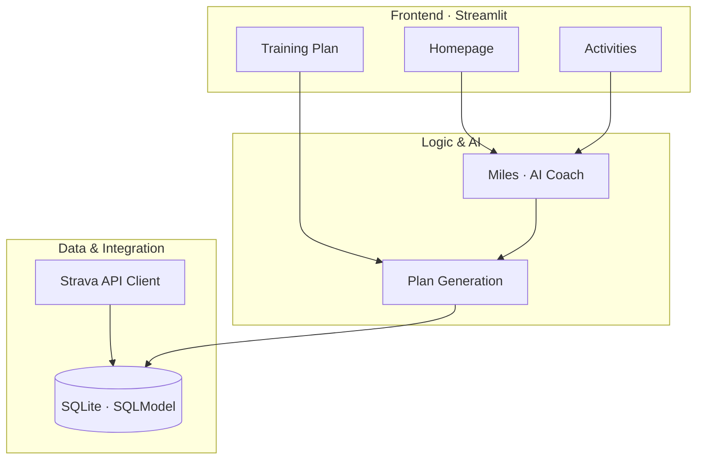

# PacePilot: Building the Running Coach I Wanted to Have

I'm a runner myself, and like many others, I enjoy tracking progress, chasing personal bests and occasionally overthinking my training plan.

But there's always been something missing: most training plans are relatively static. They tell you what to run on a particular day, but don't necessarily adapt when you miss a session, have an unexpectedly demanding week or make faster progress than anticipated.

At some point, I started wondering whether I could build something better. Something that understands my training history, helps me plan upcoming workouts and lets me actually discuss training decisions.

That idea became **PacePilot**.

## From running data to coaching

The idea behind PacePilot was to go beyond activity tracking. Strava already does a great job of collecting running data, but understanding that data and translating it into actionable training decisions is another challenge.

PacePilot connects to the Strava API to retrieve personal activity data and uses it as the foundation for a personalized training experience.

The project combines three main components:

- **Activity analysis:** Retrieve and process historical running activities from Strava.
- **Training plans:** Generate personalized training recommendations based on individual training history and progress.
- **AI coaching:** Interact with a conversational running coach to discuss workouts, training decisions and general running questions.

The goal was to create a feedback loop between completed workouts and future training decisions.

## Meet Miles

A central part of the project is *Miles*, an AI-powered running coach.

I didn't want to build another chatbot that simply answers generic questions about running. Miles should have access to relevant personal data and actual training knowledge.

The implementation combines LLMs with an external knowledge base containing sports-science concepts and training principles. Using LangChain and LangGraph, I experimented with structuring conversational workflows and providing the model with the context needed to give more relevant answers.

For example, instead of asking a generic chatbot how to prepare for a half marathon, you could discuss your recent training volume, ask why a particular workout is recommended or explore how to adjust your plan after missing a session.

One principle guided the implementation: **the LLM should help interpret and communicate information, not replace the underlying training logic.**

## The engineering behind it

PacePilot is primarily a Python application built around a relatively lightweight architecture. Streamlit provides the interface, while the application logic is separated into dedicated modules for activity handling, training plan generation and AI coaching.

The Strava integration handles authentication and activity retrieval. SQLite and SQLModel provide persistence for athlete and running data, which are then used by the planning and coaching components.

The following diagram illustrates the main modules and their dependencies:

The main technology choices were:

| Area | Technology |
|---|---|
| Interface | Streamlit |
| AI orchestration | LangChain, LangGraph |
| Language models | OpenAI API |
| Activity integration | Strava API |
| Data validation | Pydantic |
| Persistence | SQLite, SQLModel |
| Visualization | Plotly |

The interesting part wasn't just integrating an LLM. It was connecting external APIs, structured activity data, training knowledge and conversational interactions into one coherent application.
## A project whose timing tells its own story

PacePilot was particularly interesting because of when I built it.

LLMs were already capable enough to build useful conversational applications, but they weren't quite as powerful as today's models. Getting something meaningful out of them required considerably more thought around context, orchestration and external data.

Since then, the running-tech landscape has evolved considerably.

Strava introduced **Athlete Intelligence** to provide AI-powered insights into workout data. In April 2025, Strava also announced its acquisition of **Runna**, a dedicated running coaching platform offering personalized training plans.

In other words, the exact intersection I was experimenting with has become an increasingly important part of established fitness products.

That also makes me realistic about PacePilot's commercial potential. Competing with platforms that already have millions of users, extensive training data and dedicated coaching teams was never particularly realistic. I don't expect this project to become a commercial product.

But that was never really the point.

## Looking back

PacePilot was a fun project that brought together two things I genuinely enjoy: running and building software.

More importantly, it gave me the opportunity to explore LLM-based application development at a time when the technology was becoming powerful enough to enable entirely new kinds of applications.

Some of the ideas behind PacePilot might now be available directly in mainstream products. That's fine. Sometimes the value of a side project isn't building the next big product, but exploring an idea, learning new technologies and solving a problem you personally find interesting.

And if it helps me become a better runner along the way, even better.

---

**Explore the project:** [PacePilot on GitHub](https://github.com/jannikseus/pacepilot)

**Further reading:** [Strava Athlete Intelligence](https://press.strava.com/articles/strava-launches-athlete-intelligence) · [Strava's announcement of the Runna acquisition](https://press.strava.com/articles/strava-to-acquire-runna-a-leading-running-training-app)