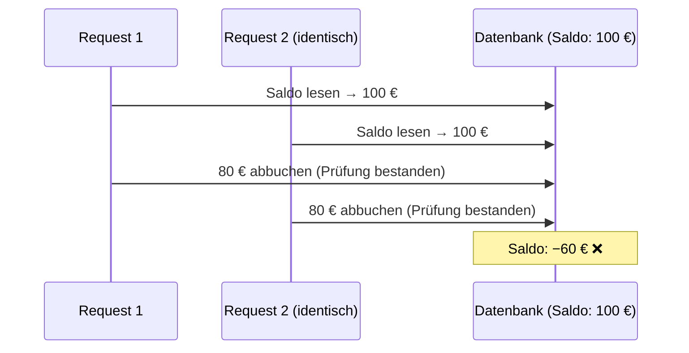
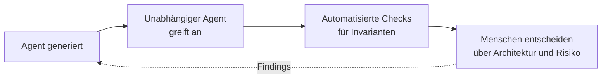

# KI macht Code billig — Testen wird zum Engpass

> **Kurz gesagt:** KI beschleunigt das *Schreiben* von Software enorm. Aber ob der Code korrekt, sicher und wartbar ist, muss weiterhin jemand belegen. Je billiger die Generierung wird, desto knapper wird die Verifikation. Genau dort liegt die spannendere Chance für KI.

Codegenerierung wird immer günstiger. Entwickler:innen können bereits ganze Features, Service-Gerüste und Datenbankanbindungen generieren lassen. Das ist nützlich, und es gibt wenig Grund anzunehmen, dass es wieder aufhört.

Aber **Software generieren** und **verlässliche Software ausliefern** sind zwei verschiedene Dinge. Beschleunigt KI das Erste, wird unsere Fähigkeit, das Ergebnis zu prüfen, zum Engpass.

---

## 1. Die Verifikationslücke

Ein KI-Agent erzeugt in wenigen Tagen 50.000 Zeilen für einen neuen internen Service. Er baut, die Tests sind grün, der Pull Request sieht beeindruckend aus. Aber niemand prüft 50.000 fremde Zeilen mit dem gleichen Vertrauen wie 5.000 selbst geschriebene. Und ein zweites KI-System als Reviewer hilft nur begrenzt: Beide können dieselben blinden Flecken haben, ein überzeugendes Review ist kein Beweis.

**Ein Beispiel, das ein schneller Review übersieht:** Ein generiertes Dokumenten-API authentifiziert Nutzer, prüft Zugriffsrechte aber über eine Organisations-ID aus dem Request statt über die authentifizierte Session. Wer eine fremde Organisations-ID errät, kommt an deren Dokumente. Nichts stürzt ab, die Unit-Tests laufen durch. Diese Fehlerklasse heißt **Broken Object Level Authorization** und steht auf Platz 1 der [OWASP API Security Top 10](https://owasp.org/www-project-api-security/) [^owasp].

Das ist kein KI-exklusives Problem, Menschen machen dieselben Fehler. Der Unterschied ist die Menge: Fu et al. fanden in **29,5 %** der untersuchten Copilot-Python-Snippets und **24,2 %** der JavaScript-Snippets aus echten GitHub-Projekten Sicherheitsschwächen [^fu]. Wächst die Codemenge schneller als die Prüfkapazität, funktioniert „Trust but verify“ nicht mehr.

---

## 2. Hier wird KI beim Testen interessant

Wang et al. werteten **102 Studien** zum Testen mit großen Sprachmodellen aus [^wang]. Besonders spannend ist **adversariales Testen**: nicht „funktioniert es?“, sondern „wie geht es kaputt?“. Ein Agent bekommt API, Spezifikation und Testumgebung und versucht, Annahmen zu verletzen.

Oder bei einer Überweisung: Was passiert, wenn derselbe Request **gleichzeitig** zweimal ankommt?

**Belege:** Fuzz4All fand **98 Bugs** in GCC, Clang, Z3, OpenJDK und weiteren, **64** davon als unbekannt bestätigt [^fuzz4all]. TitanFuzz fand in Deep-Learning-Bibliotheken **65 Bugs**, **44** davon unbekannt [^titanfuzz].

**Aber:** Tests erzeugen ist nicht Bugs finden. In einer Benchmarking-Studie fanden sieben API-Level-Fuzzer für Deep-Learning-Bibliotheken zusammen nur **6,5 % (34 von 517)** realer Bugs [^bench]. (Das betrifft Einzel-API-Fuzzer, keine Aussage über KI-Testing insgesamt.) Auch KI-Tests brauchen unabhängige Orakel, aussagekräftige Assertions, reproduzierbare Umgebungen und die Bestätigung eines Fundes, bevor er als Defekt gilt.

> Das Ziel ist nicht, mehr Tests zu generieren, sondern mehr Fehler zu finden.

---

## 3. Wir haben schon genug Software

Für fast jedes Geschäftsproblem existiert bereits eine Lösung, mit Jahren an gewachsener Logik. Wird der Bau neuer Tools billiger, sinkt deren Grenznutzen. Der Wert verlässlicher Bestandssysteme nicht: Eine Autorisierungslücke legt Daten offen, eine Race Condition verursacht Doppelbuchungen, eine kaputte Migration wird zum Incident. Mehr Engineering-Kapazität kann in Zuverlässigkeit fließen statt in noch ein Dashboard.

---

## 4. Die Rolle von Entwickler:innen verschiebt sich

Code zu schreiben wird ein kleinerer Teil des Jobs. Wichtiger werden **Security-Denken**, **Systemdesign**, **kritisches Review** und **Teststrategie**: definieren, was getestet werden muss, KI-Funde bewerten, echte Schwachstellen von Fehlalarmen trennen. Und die Verantwortung lässt sich nicht an einen Agenten delegieren.

---

## Fazit

Möglichst viel Code zu produzieren war nie das Ziel der Softwareentwicklung, sondern Systeme, die unter realen Bedingungen korrekt laufen. Je mehr Code wir generieren, desto wichtiger wird es, ihn zu testen und herauszufordern.

**KI macht das Schreiben von Software billiger. Sicherzustellen, dass sie funktioniert und auch bei jeder Änderung funktional bleibt, wird zur eigentlichen Ingenieursaufgabe.**

---

## Quellen

[^owasp]: OWASP API Security Project: *API Security Top 10 2023*, API1:2023 – Broken Object Level Authorization. <https://owasp.org/www-project-api-security/>

[^fu]: Fu, Y., Liang, P., Tahir, A., Li, Z., Shahin, M., Yu, J., Chen, J.: *Security Weaknesses of Copilot-Generated Code in GitHub Projects: An Empirical Study*. ACM TOSEM, 2025. <https://arxiv.org/abs/2310.02059>

[^wang]: Wang, J., Huang, Y., Chen, C., Liu, Z., Wang, S., Wang, Q.: *Software Testing with Large Language Models: Survey, Landscape, and Vision*. IEEE TSE, 50(4), 2024. <https://doi.org/10.1109/TSE.2024.3368208>

[^fuzz4all]: Xia, C. S. et al.: *Fuzz4All: Universal Fuzzing with Large Language Models*. ICSE 2024. <https://doi.org/10.1145/3597503.3639121>

[^titanfuzz]: Deng, Y. et al.: *Large Language Models Are Zero-Shot Fuzzers*. ISSTA 2023. <https://doi.org/10.1145/3597926.3598067> (Die frühe arXiv-Fassung nennt 41 statt 44 bestätigte unbekannte Bugs; zitiert ist die veröffentlichte Version.)

[^bench]: *Evaluating API-Level Deep Learning Fuzzers: A Comprehensive Benchmarking Study*. ACM. <https://dl.acm.org/doi/10.1145/3729533>