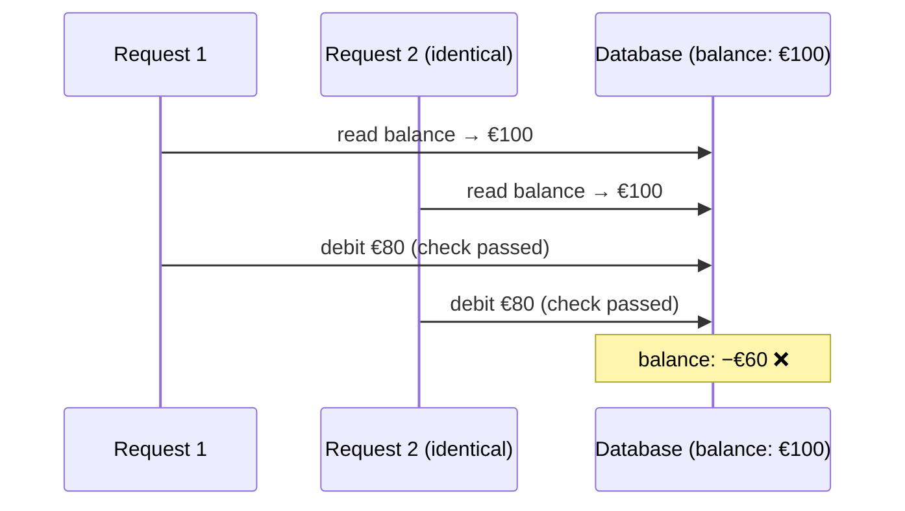
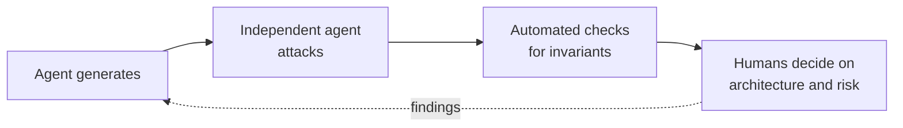

> **In short:** AI hugely accelerates *writing* software. But someone still has to show that the code is correct, secure, and maintainable. The cheaper generation gets, the scarcer verification becomes. That is where AI's more interesting opportunity lies.

Code generation keeps getting cheaper. Developers can already have AI generate entire features, service scaffolding, and database integrations. That is useful, and there is little reason to expect it to stop.

But **generating software** and **delivering reliable software** are two different things. If AI speeds up the first, our ability to verify the result becomes the bottleneck.

---

## 1. The Verification Gap

An AI agent produces 50,000 lines for a new internal service in a few days. It builds, the tests are green, the pull request looks impressive. But nobody audits 50,000 unfamiliar lines with the same confidence as 5,000 they wrote themselves. And a second AI system as reviewer only helps so much: both can share the same blind spots, and a convincing review is not proof.

**An example a quick review will miss:** A generated document API authenticates users, but validates organization access using an ID supplied by the client instead of the authenticated session. Anyone who guesses another organization's ID can access its documents. Nothing crashes, the unit tests pass. This class of flaw is called **Broken Object Level Authorization** and ranks first in the [OWASP API Security Top 10](https://owasp.org/www-project-api-security/) [^owasp].

This is not an AI-only problem; humans make the same mistakes. The difference is volume: Fu et al. found security weaknesses in **29.5%** of the Copilot-generated Python snippets and **24.2%** of the JavaScript snippets they examined from real GitHub projects [^fu]. When the amount of code grows faster than the capacity to review it, "trust but verify" stops working.

---

## 2. Where AI Gets Interesting for Testing

Wang et al. reviewed **102 studies** on testing with large language models [^wang]. Particularly promising is **adversarial testing**: not "does it work?", but "how does it break?". An agent gets an API, its specification, and a test environment, and tries to violate the system's assumptions.

Or take a money transfer: what happens when the same request arrives **twice at the same time**?

**Evidence:** Fuzz4All found **98 bugs** in GCC, Clang, Z3, OpenJDK, and others, **64** of them confirmed as previously unknown [^fuzz4all]. TitanFuzz found **65 bugs** in deep-learning libraries, **44** of them previously unknown [^titanfuzz].

**But:** generating tests is not the same as finding bugs. In one benchmarking study, seven API-level fuzzers for deep-learning libraries together found only **6.5% (34 of 517)** of real-world bugs [^bench]. (This concerns single-API fuzzers, not AI testing as a whole.) AI-driven tests also need independent oracles, meaningful assertions, reproducible environments, and confirmation of a finding before it counts as a defect.

> The goal is not to generate more tests, but to find more failures.

---

## 3. We Already Have Enough Software

For almost every business problem a solution already exists, with years of accumulated logic. As building new tools gets cheaper, their marginal value drops. The value of reliable existing systems does not: an authorization flaw exposes data, a race condition causes double bookings, a broken migration turns into an incident. More engineering capacity can go into reliability instead of yet another dashboard.

---

## 4. The Developer's Role Is Shifting

Writing code becomes a smaller part of the job. **Security thinking**, **systems design**, **critical review**, and **testing strategy** become more important: defining what must be tested, evaluating AI findings, separating real vulnerabilities from false alarms. And accountability cannot be delegated to an agent.

---

## Conclusion

Producing as much code as possible was never the goal of software engineering; the goal was systems that behave correctly under real-world conditions. The more code we generate, the more important it becomes to test and challenge it.

**AI makes writing software cheaper. Making sure it works, and that it stays functional with every change, becomes the real engineering task.**

---

## Sources

[^owasp]: OWASP API Security Project: *API Security Top 10 2023*, API1:2023 – Broken Object Level Authorization. <https://owasp.org/www-project-api-security/>

[^fu]: Fu, Y., Liang, P., Tahir, A., Li, Z., Shahin, M., Yu, J., Chen, J.: *Security Weaknesses of Copilot-Generated Code in GitHub Projects: An Empirical Study*. ACM TOSEM, 2025. <https://arxiv.org/abs/2310.02059>

[^wang]: Wang, J., Huang, Y., Chen, C., Liu, Z., Wang, S., Wang, Q.: *Software Testing with Large Language Models: Survey, Landscape, and Vision*. IEEE TSE, 50(4), 2024. <https://doi.org/10.1109/TSE.2024.3368208>

[^fuzz4all]: Xia, C. S. et al.: *Fuzz4All: Universal Fuzzing with Large Language Models*. ICSE 2024. <https://doi.org/10.1145/3597503.3639121>

[^titanfuzz]: Deng, Y. et al.: *Large Language Models Are Zero-Shot Fuzzers*. ISSTA 2023. <https://doi.org/10.1145/3597926.3598067> (The early arXiv version reports 41 instead of 44 confirmed previously unknown bugs; the published version is cited here.)

[^bench]: *Evaluating API-Level Deep Learning Fuzzers: A Comprehensive Benchmarking Study*. ACM. <https://dl.acm.org/doi/10.1145/3729533>